# Engineering Knowledge Hub

## 1. Vision

Engineering Knowledge Hub is a local-first internal engineering knowledge platform for a software + hardware company. Its purpose is to preserve company knowledge, make troubleshooting reusable, and later provide AI/RAG assistance without making AI the source of truth.

### Core rule

> Local knowledge is always available without Internet. Internet is optional enrichment, not a dependency for core knowledge retrieval.

The platform stores internal documentation, troubleshooting guides, installation/configuration procedures, known issues, resolved incidents, engineer experience, imported vendor documentation, and supporting evidence.

---

## 2. Product Principles

1. **Local-first:** core search and knowledge retrieval work without Internet.
2. **Evidence-first:** important answers should point to articles, documents, incidents, or sources.
3. **AI is not truth:** AI can retrieve, summarize, connect, and infer, but cannot silently publish knowledge.
4. **Human validation:** important knowledge can pass Draft → Review → Verified → Published.
5. **Traceability:** preserve author, source, reviewer, version, and related incidents.
6. **Provider independence:** AI, embedding, and vector providers remain replaceable.
7. **Incremental delivery:** MVP is useful without AI; AI/RAG is added later.

---

## 3. Users

### Engineer

Searches solutions, procedures, product information, previous incidents, and troubleshooting steps.

### Senior Engineer

Reviews submissions, validates solutions, adds technical experience, and maintains procedures.

### Support Engineer

Uses fast problem lookup, incident history, known issues, and diagnostics.

### Knowledge Administrator

Manages taxonomy, sources, products, technologies, review queues, and knowledge quality.

### System Administrator

Manages users, roles, permissions, configuration, auditing, and system health.

---

## 4. Main User Journeys

### Find a solution

```text
Engineer → Search → Local Knowledge → Filter → Article/Incident → Feedback
```

### Add knowledge

```text
Engineer → Draft → Submit Review → Senior/Admin Review → Publish
```

### Convert incident to knowledge

```text
Incident → Root Cause → Resolution → Knowledge Proposal → Review → Publish
```

### Import external knowledge

```text
External Source → Import → Extract → Index → Optional Review → Searchable
```

### Future AI

```text
Question → Local Search → Semantic Search → Evidence → RAG → AI Answer → Sources
```

---

# 5. Knowledge Model

## KnowledgeArticle

Human-readable technical knowledge: troubleshooting, configuration, installation, FAQ, known issue, procedure, best practice, reference.

## Incident

A real problem encountered by an engineer, including symptoms, root cause, resolution, and environment.

## KnowledgeSource

The origin of information: internal, external, vendor documentation, incident, imported document, or AI suggestion.

## Product

Company systems such as ANPR, Toll Collection, Camera Management, Barrier Control, Monitoring.

## Technology

Technical domains such as SQL Server, ASP.NET Core, WPF, Windows, Networking, RTSP, ONVIF, IIS.

## Document

An imported PDF/DOCX/TXT/Markdown/HTML/image/log source that can later be processed and indexed.

---

# 6. Trust Model

Knowledge states:

- Draft
- PendingReview
- Verified
- Published
- Deprecated
- Archived

Source types:

- Internal
- External
- Incident
- EngineerExperience
- VendorDocumentation
- SystemGenerated
- AISuggested

The UI must clearly distinguish internal verified knowledge from external information and AI inference.

---

# 7. Architecture

Recommended baseline:

```text
EngineeringKnowledgeHub
├── EngineeringKnowledgeHub.Api
├── EngineeringKnowledgeHub.Application
├── EngineeringKnowledgeHub.Domain
├── EngineeringKnowledgeHub.Infrastructure
└── EngineeringKnowledgeHub.Tests
```

Future optional projects:

```text
EngineeringKnowledgeHub.Desktop
EngineeringKnowledgeHub.Worker
EngineeringKnowledgeHub.AI
```

Dependency direction:

```text
API → Application → Domain
Infrastructure → Application → Domain
```

Domain must not depend on EF Core, ASP.NET Core, SQL Server, AI SDKs, HTTP clients, or UI.

AI integrations must be behind interfaces.

---

# 8. Database Design

SQL Server + EF Core.

## Core entities

```text
User
Role
UserRole

KnowledgeArticle
KnowledgeCategory
KnowledgeType
KnowledgeTag
ArticleTag

Product
Technology
ArticleProduct
ArticleTechnology

Incident
IncidentArticle

KnowledgeSource
ArticleSource
Document
DocumentChunk

KnowledgeFeedback
KnowledgeVersion
AuditLog
```

## Entity fields

### User

```text
Id
Username
DisplayName
Email
PasswordHash / identity reference
IsActive
CreatedAt
UpdatedAt
```

### Role

```text
Id
Name
Description
```

### UserRole

```text
UserId
RoleId
```

### KnowledgeArticle

```text
Id
Title
Slug
Summary
Content
KnowledgeTypeId
Status
VerificationStatus
AuthorId
ReviewerId
CreatedAt
UpdatedAt
PublishedAt
LastReviewedAt
```

### KnowledgeCategory

```text
Id
Name
Description
ParentCategoryId
```

### KnowledgeType

```text
Id
Name
Description
```

### KnowledgeTag

```text
Id
Name
```

### ArticleTag

```text
ArticleId
TagId
```

### Product

```text
Id
Name
Code
Description
IsActive
```

### Technology

```text
Id
Name
Description
```

### ArticleProduct

```text
ArticleId
ProductId
```

### ArticleTechnology

```text
ArticleId
TechnologyId
```

### Incident

```text
Id
Title
ProblemDescription
Symptoms
RootCause
Resolution
Severity
Status
CreatedById
ResolvedById
CreatedAt
ResolvedAt
```

### IncidentArticle

```text
IncidentId
ArticleId
RelationshipType
```

### KnowledgeSource

```text
Id
Name
SourceType
Url
Description
TrustLevel
IsApproved
CreatedAt
UpdatedAt
```

### ArticleSource

```text
ArticleId
SourceId
ReferenceText
```

### Document

```text
Id
FileName
StoragePath
ContentType
FileHash
SourceId
ProcessingStatus
UploadedById
CreatedAt
```

### DocumentChunk

```text
Id
DocumentId
ChunkIndex
Content
TokenCount
EmbeddingReference
CreatedAt
```

This entity is the future RAG foundation. Do not hard-code a specific vector provider into it.

### KnowledgeFeedback

```text
Id
ArticleId
UserId
FeedbackType
Comment
CreatedAt
```

### KnowledgeVersion

```text
Id
ArticleId
VersionNumber
Title
Content
ChangedById
ChangeSummary
CreatedAt
```

### AuditLog

```text
Id
UserId
Action
EntityName
EntityId
Details
CreatedAt
```

---

# 9. Database ER Diagram

```mermaid
erDiagram
    User {
        uniqueidentifier Id PK
        string Username
        string DisplayName
        string Email
        string PasswordHash
        bool IsActive
        datetime CreatedAt
        datetime UpdatedAt
    }
    Role {
        uniqueidentifier Id PK
        string Name
        string Description
    }
    UserRole {
        uniqueidentifier UserId PK, FK
        uniqueidentifier RoleId PK, FK
    }
    KnowledgeArticle {
        uniqueidentifier Id PK
        string Title
        string Slug
        string Summary
        text Content
        uniqueidentifier KnowledgeTypeId FK
        string Status
        string VerificationStatus
        uniqueidentifier AuthorId FK
        uniqueidentifier ReviewerId FK
        datetime CreatedAt
        datetime UpdatedAt
        datetime PublishedAt
        datetime LastReviewedAt
    }
    KnowledgeCategory {
        uniqueidentifier Id PK
        string Name
        string Description
        uniqueidentifier ParentCategoryId FK
    }
    KnowledgeType {
        uniqueidentifier Id PK
        string Name
        string Description
    }
    KnowledgeTag {
        uniqueidentifier Id PK
        string Name
    }
    ArticleTag {
        uniqueidentifier ArticleId PK, FK
        uniqueidentifier TagId PK, FK
    }
    Product {
        uniqueidentifier Id PK
        string Name
        string Code
        string Description
        bool IsActive
    }
    Technology {
        uniqueidentifier Id PK
        string Name
        string Description
    }
    ArticleProduct {
        uniqueidentifier ArticleId PK, FK
        uniqueidentifier ProductId PK, FK
    }
    ArticleTechnology {
        uniqueidentifier ArticleId PK, FK
        uniqueidentifier TechnologyId PK, FK
    }
    Incident {
        uniqueidentifier Id PK
        string Title
        text ProblemDescription
        text Symptoms
        text RootCause
        text Resolution
        string Severity
        string Status
        uniqueidentifier CreatedById FK
        uniqueidentifier ResolvedById FK
        datetime CreatedAt
        datetime ResolvedAt
    }
    IncidentArticle {
        uniqueidentifier IncidentId PK, FK
        uniqueidentifier ArticleId PK, FK
        string RelationshipType
    }
    KnowledgeSource {
        uniqueidentifier Id PK
        string Name
        string SourceType
        string Url
        string Description
        string TrustLevel
        bool IsApproved
        datetime CreatedAt
        datetime UpdatedAt
    }
    ArticleSource {
        uniqueidentifier ArticleId PK, FK
        uniqueidentifier SourceId PK, FK
        string ReferenceText
    }
    Document {
        uniqueidentifier Id PK
        string FileName
        string StoragePath
        string ContentType
        string FileHash
        uniqueidentifier SourceId FK
        string ProcessingStatus
        uniqueidentifier UploadedById FK
        datetime CreatedAt
    }
    DocumentChunk {
        uniqueidentifier Id PK
        uniqueidentifier DocumentId FK
        int ChunkIndex
        text Content
        int TokenCount
        string EmbeddingReference
        datetime CreatedAt
    }
    KnowledgeFeedback {
        uniqueidentifier Id PK
        uniqueidentifier ArticleId FK
        uniqueidentifier UserId FK
        string FeedbackType
        string Comment
        datetime CreatedAt
    }
    KnowledgeVersion {
        uniqueidentifier Id PK
        uniqueidentifier ArticleId FK
        int VersionNumber
        string Title
        text Content
        uniqueidentifier ChangedById FK
        string ChangeSummary
        datetime CreatedAt
    }
    AuditLog {
        uniqueidentifier Id PK
        uniqueidentifier UserId FK
        string Action
        string EntityName
        string EntityId
        text Details
        datetime CreatedAt
    }
    User ||--o{ UserRole : has
    Role ||--o{ UserRole : contains
    User ||--o{ KnowledgeArticle : authors
    User ||--o{ KnowledgeArticle : reviews
    KnowledgeType ||--o{ KnowledgeArticle : classifies
    KnowledgeCategory ||--o{ KnowledgeCategory : parent_of
    KnowledgeArticle ||--o{ ArticleTag : tagged
    KnowledgeTag ||--o{ ArticleTag : contains
    KnowledgeArticle ||--o{ ArticleProduct : relates
    Product ||--o{ ArticleProduct : contains
    KnowledgeArticle ||--o{ ArticleTechnology : relates
    Technology ||--o{ ArticleTechnology : contains
    User ||--o{ Incident : creates
    User ||--o{ Incident : resolves
    Incident ||--o{ IncidentArticle : related_to
    KnowledgeArticle ||--o{ IncidentArticle : supported_by
    KnowledgeArticle ||--o{ ArticleSource : cites
    KnowledgeSource ||--o{ ArticleSource : referenced_by
    KnowledgeSource ||--o{ Document : provides
    Document ||--o{ DocumentChunk : contains
    User ||--o{ KnowledgeFeedback : gives
    KnowledgeArticle ||--o{ KnowledgeFeedback : receives
    KnowledgeArticle ||--o{ KnowledgeVersion : versions
    User ||--o{ KnowledgeVersion : changes
    User ||--o{ AuditLog : performs
```



---

# 10. Database Rules

- Use soft deletion for valuable knowledge.
- Use optimistic concurrency for editing.
- Published knowledge must be versioned.
- Preserve historical versions through immutable knowledge versions.
- Governance actions create audit history.
- Version numbers are deterministic and unique per article.
- Historical versions are immutable and not mutated.
- Add unique constraints for usernames, emails, product codes, tag names, article slugs, (articleId, versionNumber), and document hashes.
- Add indexes based on real query patterns.
- Avoid a generic repository layer unless a concrete need appears.

---

# 11. Search Strategy

### Local-First Keyword & Metadata Search Foundation

The search engine distinguishes between text keyword matching and structured criteria filtering:

```text
Keyword search:
- Title
- Summary
- Content

Structured metadata filters:
- Product
- Technology
- KnowledgeType
- Tag
- Status
- VerificationStatus
```

Keyword search operates as case-insensitive substring matching over text fields, while taxonomy dimensions and lifecycle states act as structured query filters. Source and Date filtering are introduced in subsequent source/persistence phases.

### Future Search Evolution

- **Semantic Search**: Vector embeddings and semantic similarity retrieval across document chunks and articles (Phase 7).
- **Hybrid Retrieval**: Combining keyword relevance, semantic similarity, verification status, and product/technology relevance (Phase 7).
- **RAG**: Retrieval-Augmented Generation with evidence and source attribution (Phase 8).

---

# 12. Online / Offline Behavior

## Offline

The application can:

- Search local knowledge
- Read articles
- Search incidents
- Search documents
- Use semantic search if locally configured
- Use a local LLM if configured

It cannot perform external enrichment unless Internet is restored.

## Online

The application may:

- Enrich with approved external sources
- Import documentation
- Synchronize external sources
- Use configured cloud AI
- Propose new knowledge

External knowledge remains clearly identified as external.

---

# 13. Future AI Architecture

Keep AI provider-independent:

```text
IAiProvider
IEmbeddingProvider
IKnowledgeRetriever
ISemanticSearch
IDocumentProcessor
IExternalKnowledgeProvider
```

Possible implementations later:

```text
LocalLlmProvider
OpenAiProvider
OtherProvider
LocalEmbeddingProvider
CloudEmbeddingProvider
```

RAG flow:

```text
Question
 ↓
Local keyword search
 ↓
Local semantic search
 ↓
Evidence ranking
 ↓
Optional external retrieval
 ↓
Context builder
 ↓
AI provider
 ↓
Answer + citations/evidence
```

If evidence is insufficient, the system should say so instead of fabricating a solution.

---

# 14. Design System

The product is an engineering tool, not a marketing website.

## Visual direction

- Professional
- Technical
- Calm
- Fast
- High information density without clutter
- Excellent scanability
- Minimal decorative animation
- No excessive glassmorphism
- No giant hero sections
- No tiny text

## Colors

```text
Background       #F6F8FB
Secondary        #EEF2F7
Surface          #FFFFFF
Primary Text     #172033
Secondary Text   #596579
Muted Text       #7C8798
Border           #D9E0EA
Strong Border    #C7D0DD
Primary          #2563EB
Primary Hover    #1D4ED8
Primary Soft     #E8F0FF
Success          #16A34A
Warning          #D97706
Danger           #DC2626
Info             #0891B2
```

## Typography

- Inter where available
- Segoe UI fallback on Windows
- Arabic-compatible fallback

```text
Page title       28px
Section title    20px
Card title       16px
Body             14-15px
Secondary        13px
Metadata         12px
```

## Main layout

```text
┌─────────────────────────────────────────────────────────────┐
│ Top Bar                                      User / Status   │
├───────────────┬─────────────────────────────────────────────┤
│ Navigation    │                                             │
│               │                 Main Content                │
│ Dashboard     │                                             │
│ Knowledge     │                                             │
│ Incidents     │                                             │
│ Products      │                                             │
│ Technologies  │                                             │
│ Sources       │                                             │
│ Documents     │                                             │
│               │                                             │
│ Administration│                                             │
└───────────────┴─────────────────────────────────────────────┘
```

---

# 15. Main Screens

## Dashboard

- Global search
- Recent knowledge
- Popular knowledge
- Recent incidents
- Pending reviews
- Quick actions
- Knowledge health

## Global Search

Filters:

- Product
- Technology
- Knowledge type
- Status
- Source
- Date
- Tags

Result cards show title, type, product, technology, verification status, excerpt, source, and updated date.

## Article Details

```text
Title
Status / Verification
Metadata
Summary

Problem
Symptoms
Cause
Solution
Steps
Notes

Related Products
Related Technologies
Related Incidents
Sources
Version History

Was this helpful?
```

## Incident Details

Problem, symptoms, root cause, resolution, environment, product, technology, attachments, and related knowledge.

## Knowledge Editor

Structured editing is preferred over one giant plain-text field.

---

# 16. Security

Minimum requirements:

- Authentication
- Authorization
- Role-based permissions
- Secure password hashing or external identity
- Secret configuration
- Audit logging
- Input validation
- File validation
- Upload limits
- Allowed file types
- Access control for sensitive documents

Suggested roles:

```text
Admin
KnowledgeAdmin
SeniorEngineer
Engineer
SupportEngineer
Viewer
```

---

# 17. Testing Strategy

### Domain

Entity rules, validation, lifecycle, versioning.

### Application

Use cases, review workflow, search, incident-to-knowledge flow.

### Infrastructure

EF mappings, queries, constraints, transactions.

### API

Authentication, authorization, validation, error handling.

### Future AI

Retrieval quality, citation correctness, insufficient-evidence behavior, offline behavior.

---

# 18. Observability

Log:

- Application errors
- Authentication events
- Search failures
- Document processing failures
- External source failures
- AI provider failures
- Background job failures

Future metrics:

- Search count
- Zero-result searches
- Most searched problems
- Most useful articles
- Failed ingestion jobs
- Knowledge freshness
- AI feedback

---

# 19. Implementation Roadmap

## Phase 0: Foundation

Solution structure, project references, configuration, DI, logging, exception handling, health checks, tests, README, architecture rules.

## Phase 1: Core Domain Foundation (and Identity Domain)

Core domain entities, value objects, invariants, taxonomy, user/role domain models, and application boundaries. Identity authentication and authorization infrastructure follow once persistence and API boundaries are established.

## Phase 2: Knowledge Core Application Foundation

Articles, categories, types, tags, products, technologies, relationships, CRUD, validation, and review workflow application use cases.

## Phase 3: Search

Global search, filters, sorting, pagination, zero-result handling.

## Phase 4: Incidents

Incident lifecycle, incident-to-article relationship, create knowledge from incident, feedback.

## Phase 5: Documents & Sources

Sources, document upload, hashing, metadata, processing status, extraction.

## Phase 6: Governance

Versioning, approval/rejection, deprecation, audit history.

## Phase 7: Semantic Search

Chunking, embedding abstraction, vector storage abstraction, semantic retrieval, hybrid search.

## Phase 8: RAG

Retriever, context builder, AI abstraction, evidence display, answer generation.

## Phase 9: Online Enrichment

Approved external sources, import/sync, provenance, review pipeline.

## Phase 10: Local AI

Local model provider, local embeddings, offline RAG, model configuration and health monitoring.

---

# 20. Agent Workflow

The Agent must work one phase at a time.

```text
Phase prompt
 ↓
Agent inspects repository
 ↓
Implements only requested phase
 ↓
Build
 ↓
Tests
 ↓
Implementation report
 ↓
Human review
 ↓
Fix issues if needed
 ↓
Approve phase
 ↓
Next phase
```

The Agent must not perform unrelated refactors or jump ahead to later phases.

### Required feedback

```text
## Implementation Summary
## Files Created
## Files Modified
## Architecture Decisions
## Database Changes
## API Changes
## Tests Added
## Test Results
## Build Result
## Known Issues
## Technical Debt
## Assumptions
## What Was NOT Implemented
## Recommended Next Step
```

---

# 21. Definition of Done

A phase is complete only when:

- Build succeeds
- Tests pass
- Architecture boundaries remain intact
- Migrations are valid
- API behavior is tested where applicable
- Validation exists
- Error handling exists
- Logging exists where appropriate
- Security is considered
- Agent reports all changes
- Human review approves the result

---

# 22. Coding Standards

Use:

- Nullable reference types
- async/await
- CancellationToken where appropriate
- Dependency injection
- DTOs at API boundaries
- Validation
- EF Core configurations
- Explicit relationships
- Structured logging
- Meaningful names

Avoid:

- God classes
- Giant services
- Controllers containing business logic
- Static global state
- Service locator
- Hidden database access
- AI SDK references in Domain
- Premature abstractions
- Generic repositories without a concrete need

---

# 23. API Direction

Initial REST endpoints:

```text
GET    /api/knowledge
GET    /api/knowledge/{id}
POST   /api/knowledge
PUT    /api/knowledge/{id}
POST   /api/knowledge/{id}/submit-review
POST   /api/knowledge/{id}/approve
POST   /api/knowledge/{id}/reject

GET    /api/search

GET    /api/incidents
POST   /api/incidents
GET    /api/incidents/{id}
POST   /api/incidents/{id}/resolve

GET    /api/products
GET    /api/technologies
GET    /api/categories
```

---

# 24. MVP

The first usable release contains:

```text
Authentication
Users
Roles
Dashboard
Knowledge Articles
Categories
Types
Tags
Products
Technologies
Search
Article Details
Article Creation
Review Workflow
Feedback
Incidents
Incident → Knowledge
Audit basics
```

It deliberately does not require:

- AI
- RAG
- External crawling
- Vector database
- Local LLM
- Knowledge graph

---

# 25. North Star

The finished platform should become the technical memory of the engineering organization.

```text
Engineer Problem
      ↓
Search Engineering Hub
      ↓
Company Cases + Verified Procedures + Documents
      ↓
Solution
      ↓
Feedback / Incident
      ↓
Validated Knowledge
      ↓
Better Future Retrieval
      ↓
Optional AI/RAG
```

The system succeeds when an engineer naturally thinks:

> **"I have a problem. Let me search the Engineering Hub first."**

---

# 26. Non-Negotiable Decisions

1. Local knowledge works without Internet.
2. AI is optional for basic retrieval.
3. AI is not the source of truth.
4. Knowledge provenance is preserved.
5. External knowledge remains distinguishable from verified internal knowledge.
6. Published knowledge is versioned.
7. Important changes are auditable.
8. AI providers are replaceable.
9. Vector storage is replaceable.
10. Document ingestion is extensible.
11. Domain has no infrastructure/AI dependencies.
12. MVP is useful without AI.
13. Every phase is independently buildable and testable.
14. Agent does not silently refactor unrelated code.
15. Every phase ends with a structured report.

---

# 27. Supervisory Workflow

This project will be built with an Agent under human review.

```text
Human
  ↓
Phase Specification
  ↓
Agent
  ↓
Implementation
  ↓
Build + Tests
  ↓
Feedback Report
  ↓
Review
  ├── Issues → Fix prompt → Re-review
  └── Approved → Next phase
```

This document is the architectural source of truth. If an implementation conflicts with it, the Agent must explicitly report the conflict instead of silently changing the architecture.
